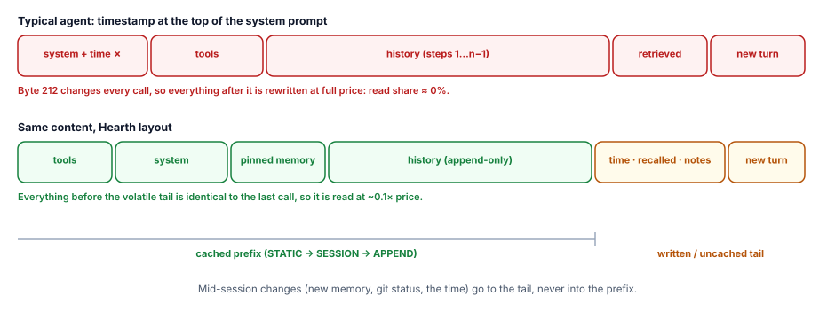
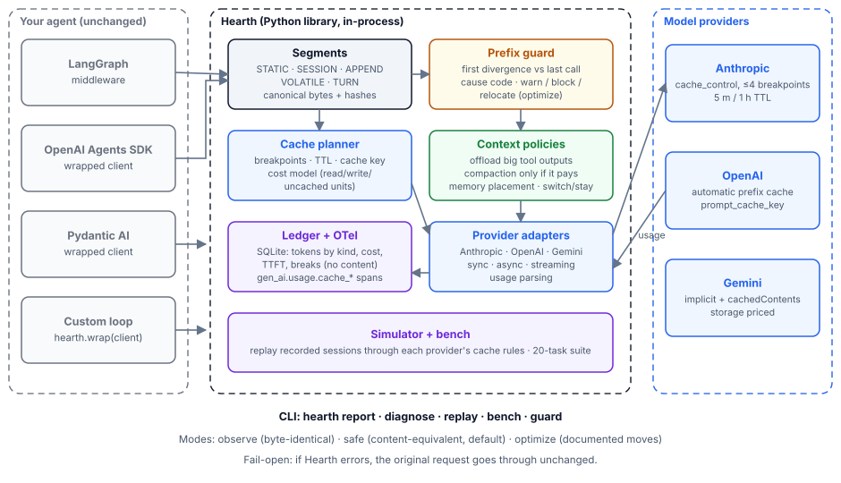
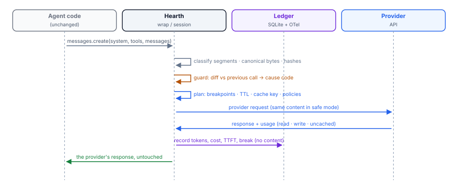
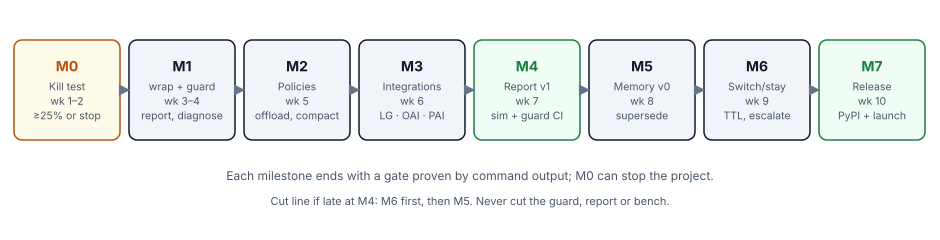

[TOC]

## 1. One page: what we are building

**Hearth is a Python library that sits between an agent's code and the model API.** It decides, on every call, what goes into the context and in what order. That keeps the provider's prompt cache valid from step to step, so the agent pays roughly a tenth of the price for everything it has already sent, and gets its first token sooner.

| | |
|---|---|
| **Who uses it** | Engineers running agents on Anthropic, OpenAI or Gemini models: LangGraph, the OpenAI Agents SDK, Pydantic AI, or a custom loop |
| **How they adopt it** | `pip install hearth-ai` and one line: `client = hearth.wrap(anthropic.Anthropic())`. Their agent code does not change, and the default mode changes no content |
| **What they get** | A per-session report of cache hits, cost and latency. Automatic fixes for the layout mistakes that break the cache. A replay tool that tests a change before it ships. Later: memory and model switching that respect the cache |
| **What proves it** | The same agents on the same tasks, with and without Hearth: cost per task, cache-read share, time to first token, and task success unchanged |
| **What it is not** | Not an agent framework, not a gateway or proxy, not a hosted service, not a vector database, not a UI |

**The one idea everything rests on:** memory, compaction, tool-output handling and model switching all look like separate products. Each of them is really a decision about the context, and each has a cache cost. Hearth is the one place that makes those decisions together, with the cost written down.

**Why it is credible to build now.** These are **Established** facts from public sources:
- Providers charge about 0.1× for cached input. Some 2026 models charge 0.05× or less.
- An independent study of 500+ agent sessions measured 41–80% lower cost and 13–31% faster time to first token from caching done well.
- Public issue trackers show agents in Claude Code, Mastra, the OpenAI Agents SDK, opencode, smolagents and others losing most of that benefit through the same handful of layout mistakes (§3).

## 2. The mental model

### 2.1 An agent resends everything, every step

An agent is a loop. On step *n* it sends the system prompt, the tool definitions, and every previous message and tool result, then appends one new piece. A 30-step task sends the same early material 30 times.

### 2.2 The provider caches the unchanged beginning

Providers keep the model's internal state for a **prefix** they have recently seen. If the beginning of the new request is byte-for-byte identical to a recent one, that part is read from cache:

| | Anthropic | OpenAI (GPT-5.6 and later) | Gemini |
|---|---|---|---|
| How caching is turned on | Explicit `cache_control` breakpoints (max 4), or one top-level automatic breakpoint that follows the conversation | Automatic on exact prefix; optional explicit `prompt_cache_breakpoint` (max 4 writes) | Implicit on 2.5 and later; explicit `cachedContents` objects with storage charges |
| Read price | 0.1× base input (0.05× on Opus 5.5 and Sonnet 5.5; 0.025× on Fable 5.1) | 0.1× (0.05× on GPT-6.1 Sol) | About 0.1× (model-specific), plus hourly storage for explicit caches |
| Write price | 1.25× (5-minute TTL) or 2× (1-hour TTL) | 1.25× | Storage per hour (explicit) |
| Minimum prefix | 512 to 4,096 tokens, depending on the model | 1,024 tokens | 2,048 to 4,096 tokens |
| Lifetime | 5 min, refreshed on each hit, or 1 h | 30 min (GPT-5.6 and later) | 1 h default (explicit) |
| Where usage is reported | `cache_read_input_tokens`, `cache_creation_input_tokens` | `input_tokens_details.cached_tokens`, `cache_write_tokens` | `usageMetadata.cachedContentTokenCount` |

These are **To verify** values, checked on 16 Oct 2026 from the providers' own documentation. They live in a dated data file in the repo (`src/hearth/data/providers.toml`), never in code, and a nightly contract test (§9) catches drift.

### 2.3 One changed byte early in the prompt costs everything after it

**Anthropic** caches at three levels, in this order: **tools, then system, then messages**. A change invalidates its own level and every level after it:

| Change | Tools level | System level | Messages level |
|---|---|---|---|
| Tool definitions | invalid | invalid | invalid |
| Web search or citations toggle, speed setting | valid | invalid | invalid |
| `tool_choice`; images added or removed | valid | valid | invalid |
| Thinking parameters | model-specific | model-specific | model-specific |

Anthropic also documents ways to avoid breaking the cache:
- append a mid-conversation `system` message instead of editing the top-level system prompt;
- add tools mid-session with a `tool_addition` block (beta).

**OpenAI** treats the model, tools, `parallel_tool_calls`, output format, reasoning effort, verbosity and context management as cache keys, plus any summarisation or truncation of history.

These rules are **To verify** against the live docs at M1, and they are encoded per level in `providers.toml` so the guard and the simulator model them exactly.

**Illustrative arithmetic** (my numbers, not a measurement), in units of the base input price per token:
- **The task:** 30 steps with the context growing from 10k to 70k tokens, so about 1.2M input tokens.
- **No cache hits:** about 1.2M units.
- **A stable layout:** about 85% of tokens read at 0.1× and the rest written at 1.25×, so about 0.85 × 0.1 + 0.15 × 1.25 = 0.27 of the uncached cost.

That is a **73% saving**. One timestamp at the top of the system prompt turns all of it back into full price.



### 2.4 The five stability classes

Hearth sorts every piece of context into one of five classes, and the class decides where it may go:

| Class | Examples | Rule |
|---|---|---|
| **STATIC** | Tool definitions, core system instructions | Set once per session; serialised identically every call; any change is a *prefix break* |
| **SESSION** | Memory pinned at session start, user profile, project rules | Changes only between sessions; mid-session updates go to the tail instead |
| **APPEND** | The conversation: user turns, model turns, tool results | Append only; never edited in place except by an explicit compaction event |
| **VOLATILE** | Current time, retrieved snippets for this turn, reminders, git status | Always placed in the tail, after the last cached position |
| **TURN** | The new user input or tool result for this step | Last |

This classification is how Claude Code's own team describes its fixes: reminders inside messages, not edits to the system prompt; no timestamps at the top; deterministic tool order. Hearth turns that practice into a library anyone can use.

## 3. The evidence that the problem is real

These are public reports from 2025–26. The numbers are as reported by the authors and were not reproduced.

| Where | What broke the cache | Reported impact |
|---|---|---|
| Claude Code #47107 | `git status` text in the last system block; everything after it missed | About 6k extra cache writes per session |
| Claude Code #46644 | Memory file injected after the dynamic boundary; every memory write broke the chain | About 10× input cost on the affected turn |
| Claude Code #81967 | A tool added or removed mid-session; TTL silently downgraded | Single breaks of 161k to 274k tokens across 1,821 requests |
| Claude Code #83542 | Unknown | About $208 of a $348 session was redundant cache writes |
| OpenAI Agents SDK #5085 | Sub-agent calls via `Agent.as_tool()` | 0 of 42 eligible calls cached, while the parent got 78–90% |
| opencode #29672 | Date and workspace block, plus a skills block in the system prompt | Daily cost from $0.36 to $5.03 after an upgrade |
| Mastra #25100, #13849 | Branch, date and mode at the top; history loaded without breakpoints | About a 50% hit rate |
| smolagents #2054 | No caching support at all | A 16-step run cost $0.94 against about $0.10 estimated |
| TradingAgents #750 | Date in system messages; history wiped between stages | About a 0% hit rate |
| Vercel AI SDK #11077 | Cache control not passed through | About $375 a month against $93.50 expected |

**What already exists, and why it is not enough:**

| Existing thing | What it does | Gap Hearth fills |
|---|---|---|
| Provider automatic caching (Anthropic automatic mode, OpenAI, Gemini implicit) | Places breakpoints | Cannot stop the application changing the prefix |
| OpenAI cache diagnostics (`comparison_response_id`) and Claude Code `/usage` | Name the first cause of a miss | One provider each; diagnosis only |
| prefixcash (MIT, pre-alpha, Aug 2026; LiteLLM callback) | Measures, diagnoses and suggests fixes | Fixes are advisory; no in-process layout; no memory, compaction or routing policy |
| audit-prompt-caching (a 105-star agent skill) | Static audit of prompt builders | No runtime, no measurement |
| Langfuse, LangSmith, Helicone | Record cached-token counts and price them | No hit-rate view, no cause, no fix |
| Deep Agents, Claude Code internals | Get it right inside one harness | Not reusable elsewhere |

**The gap Hearth owns:** an in-process, provider-neutral library that *enforces* a cache-stable layout automatically, makes context decisions (offloading, compaction, memory placement, model switching) with an explicit cache cost model, and proves the effect with replay and a public benchmark.

## 4. Architecture



### 4.1 Components

| Component | Responsibility | Milestone |
|---|---|---|
| `wrap()` | Drop-in proxy for the Anthropic Messages, OpenAI Responses and Chat Completions, and Gemini clients (sync, async, streaming) | M0 (observe, Anthropic + OpenAI Responses), M1 (all modes), M2 (Gemini) |
| Segment model | Splits each request into STATIC / SESSION / APPEND / VOLATILE / TURN segments; per-message fingerprints | M1 |
| Prefix guard | Finds the first divergence from the previous call in the session; classifies the cause (§5.2) | M1 |
| Cache planner | Breakpoints, cache key, and whether caching metadata is worth adding at all (§5.3) | M1; TTL optimiser M6 |
| Provider adapters | Map to each provider's request format; parse usage fields; read provider diagnostics where they exist | M1 (Anthropic, OpenAI), M2 (Gemini) |
| Trace writer and ledger | JSONL trace per session (§6.3) plus a SQLite summary ledger | M0 (trace), M1 (ledger) |
| Policies | Offloading, compaction, memory placement, switch-or-stay | M2, M5, M6 |
| Memory | Temporal facts with supersede, write checks, recall | M5 |
| Simulator | Replays traces through each provider's cache rules | M0 prototype, M4 |
| Bench | Pre-registered task suite, mock tools, runner, report | M0, M4 |
| Integrations | LangChain/LangGraph middleware; OpenAI Agents SDK and Pydantic AI by client injection | M0 (Agents SDK, Pydantic AI), M3 (LangGraph) |
| Testing helpers | `hearth.testing.FakeProvider`: canned responses with simulated usage, so `guard` runs in CI with no API key | M4 |
| CLI | `report`, `diagnose`, `replay`, `bench`, `guard` | M1 onward |
| OTel | Spans with `gen_ai.usage.cache_read.input_tokens` and the cache-write attribute (naming in flux, D-10) | M1 |

### 4.2 Modes: adoption with no behaviour risk

| Mode | What it may change | What it does | Default |
|---|---|---|---|
| `observe` | Nothing. Byte-identical request | Records the trace (fingerprints; bodies only with `record=True`), measures, diagnoses. Hashing happens off the request path | First run |
| `safe` | **No message or tool content is added, removed or changed.** It may add caching metadata (breakpoints, `prompt_cache_key`) when the planner expects reuse. It may restore the session's **first-seen order** of tools and schema keys if the application later reorders them | Measures, diagnoses, stabilises order drift, plans caching | **Yes** |
| `optimize` | Documented moves: detected volatile values relocated to the tail; large tool outputs offloaded (if the app registered the read tool); compaction and memory policies | Everything above, plus policies | Opt-in |

**Strict flag.** `wrap(..., strict=True)` (any mode) raises `HearthPrefixBreak` *before sending* when a user-caused break is detected. It is meant for tests and CI. Fail-open (INV-07) covers only Hearth's own internal errors, never an intentional strict raise.

**Safe mode never sorts.** It keeps the application's own order for tools and schema keys, because order is part of what the model reads. It only *restores* an order the application already used earlier in the same session, and it records every restoration. The bench checks that restorations do not change task success.

### 4.3 What one call goes through



## 5. Algorithms

### 5.1 Fingerprints and serialisation

- **Per-message fingerprints:** each message, tool definition and system block gets a fingerprint, a SHA-256 of its JSON serialisation in the application's own key order. Fingerprints are cached by content, so a message seen in the previous call is not re-hashed. The cache is an LRU keyed on `(role, length, first and last 64 bytes)`, verified by full hash only on a candidate match.
- **Segment hashes** are rolling hashes over the fingerprints in order, so the first divergence is found in O(number of messages), not O(bytes).
- **Number formatting:** numbers are never round-tripped through float formatting.
- **`observe` mode:** fingerprinting runs on a background thread after the request is sent, so it adds no latency to the call.
- **Performance budget (NFR-1):** added latency in `safe` mode is p50 ≤ 2 ms and p99 ≤ 5 ms at 50k tokens of context, and p50 ≤ 5 ms at 150k. Measured at M1; if missed, a DECISIONS entry records the numbers and the optimisation plan.

### 5.2 Prefix guard and the break taxonomy

The guard compares the new call with the previous call in the same session, and reports the first divergence with the level it invalidates (§2.3). Causes are checked **in this precedence order**, and the first match wins:

| # | Cause code | Detected when | User-caused? | Fix Hearth offers |
|---|---|---|---|---|
| 1 | `below_minimum` | Prefix shorter than the model's cache minimum | No | None needed |
| 2 | `short_session` | The session ended before any reuse was possible | No | None; the planner skips caching metadata when it predicts this |
| 3 | `ttl_expired` | Prefix identical, gap since last call > TTL | No (planning) | 1-hour TTL on the stable breakpoint (M6) |
| 4 | `provider_miss` | Identical prefix within TTL, provider reported no read | No | Recorded, never blamed on the user |
| 5 | `params_changed` | Model, `tool_choice`, thinking, effort, format, `parallel_tool_calls` changed | Yes | Keep per session; switch via a sub-agent |
| 6 | `tools_changed` | Tool set or definitions differ | Yes | Declare all tools at session start; `tool_addition` where supported |
| 7 | `tools_reordered` | Same tools, different order | Yes | `safe` restores first-seen order |
| 8 | `volatile_in_prefix` | The differing bytes match a volatile pattern (timestamp, date, UUID, counter, git hash, high-entropy token) | Yes | `hearth.volatile(...)`, or `optimize` relocates it |
| 9 | `system_changed` | Any other system change | Yes | Mid-conversation system message, or move the changing part to the tail |
| 10 | `session_mutated` | A SESSION segment changed mid-session (for example a memory write) | Yes | Queue for the tail; promote next session |
| 11 | `image_toggled` | Image added or removed earlier in the prompt | Yes | Put images in the turn that needs them |
| 12 | `history_rewritten` | An earlier message differs (trimming, sliding window, mutation) | Yes, unless it is a recorded compaction | Append-only, or planned compaction |
| 13 | `no_breakpoints` | The provider needs explicit breakpoints and none were set | Yes (config) | `safe` adds them |
| 14 | `metadata_dropped` | The app set cache metadata, but it never reached the request (a framework bug) | Framework | Reported with the framework version |
| 15 | `cold_subagent` | A new session whose prefix never reaches reuse (for example sub-agent calls) | Design | Share a stable prefix with the parent, or accept |

The guard emits a `prefix_break` event that records the call, segment, level, message index, cause, tokens rewritten, and cost in USD.

### 5.3 Cost model

- **Where prices live:** all costs are computed **in USD** from `providers.toml`, which holds for each model the base input price, the output price, and the read and write multipliers. Using USD keeps different models and output tokens comparable.
- **The formula for one call:**

  ```text
  call_cost = p_in · (r · read + w · write + uncached) + p_out · output
  ```

- **Reported baseline:** `uncached_cost` is the same call with every input token at `p_in`.
- **Should caching metadata be added at all?** The planner adds it only if it expects at least one more call in the session within the TTL. It decides from the session's call rate so far, or an application hint (`s.expect_calls(n)`). This avoids paying write premiums on one-shot calls.

### 5.4 TTL choice (Anthropic, M6)

- **Default:** 5 minutes everywhere.
- **The 1-hour TTL** is used only on the **stable breakpoint** (end of STATIC/SESSION). The rolling breakpoint on the conversation tail always stays at 5 minutes, so appended tokens are never written at the 2× price.
- **Break-even** for a stable prefix of P tokens with k expected gaps longer than 5 minutes before the session ends:
  - 5-minute TTL: rewrites P at each long gap, so about 1.25 · k · P extra;
  - 1-hour TTL: one write at 2·P instead of 1.25·P, so 0.75 · P extra;
  - **use 1 hour if k ≥ 1 and the session is expected to continue past the gap.**
- **Gap prediction:** an exponentially weighted average of the session's inter-call gaps, plus application hints (`s.expect_pause()` before a human approval or a long tool).
- **Unverified rule:** whether changing a TTL on an identical prefix forces a rewrite is **To verify** at M6. Until then the planner treats a TTL change as a write and decides once per session.

### 5.5 Offloading large tool outputs (`optimize`, M2)

Hearth does not execute tools. Offloading works only when the application registers Hearth's read tool **with its own framework at session start**:

```python
tools = [*my_tools, hearth.tools.read_offloaded]   # a normal tool the framework executes
```

**Mechanism:**
- A tool result larger than the threshold (default 2,000 tokens) is stored in a local blob store, keyed by its SHA-256.
- In the outgoing request, the result is replaced by a stub carrying the handle, the size, a short preview, and an instruction to call `read_offloaded(handle, start, end)`.
- Because the stub is a pure function of the content hash, **every later call substitutes the same stub for the same result.** The prefix stays stable even though the framework resends the full result each time.
- The substitution decision for a message is made once and remembered (handle map keyed on content hash). Already-sent messages are therefore never changed.
- **If the read tool is not registered, offloading is disabled** and `hearth report` says so.

**Risk:** the model may need the full content. The M2 bench measures task success with and without offloading, and that data sets the default threshold.

### 5.6 Compaction only when it pays (M2 study)

Replacing history of H tokens with a summary of S tokens has a cost and a saving:

```text
one-time cost  = p_in · (r · H)            # summary call reads H from cache
               + p_out · S                  # summary output
               + p_in · w · (S + tail)      # rewrite after the system breakpoint
saving per later call = p_in · r · (H − S)  # H was being read from cache anyway
pays back after  k* = one-time cost / saving per call
```

**Example:** H = 50k, S = 5k, r = 0.1, w = 1.25, p_out = 5·p_in, small tail.
- One-time cost ≈ 5k + 25k + 6.3k ≈ 36k input-price units.
- Saving per later call ≈ 4.5k.
- **So compaction pays back after about 8 more calls.**

Hearth compacts when the context window requires it, or when the expected remaining calls exceed k\*. It keeps a separate breakpoint at the end of the system prompt so only the summary is rewritten. Provider-native compaction is used where available, with its usage summed correctly.

**Study:** the M2 gate includes a compaction study on long bench sessions, and its result decides how claim C-09 is worded.

### 5.7 Memory (M5)

**Store:** SQLite `facts`, with these columns:
- `scope`, `subject`, `predicate`, `value`;
- `valid_from`, `valid_to`, `superseded_by`;
- `source` (user, tool or model) and `source_session`;
- `tainted` and `created_at`.

A new value for the same scope, subject and predicate closes the old fact; it is never stored alongside as a contradiction.

**Write checks**, applied before storing:
- size limit (default 2,000 characters) → reject;
- secrets (API-key patterns, private-key headers, tokens, high-entropy strings) → reject;
- instruction-like text ("ignore previous", "from now on", "always cc/forward") → reject;
- written by a session that read untrusted tool output (`tainted`) → held as `pending` until the application confirms.

**Placement**, which is the cache insight:
- facts pinned for the session load once at session start into SESSION;
- facts recalled for a turn go into that turn's VOLATILE tail;
- facts written during a session are visible in the tail only, and are promoted into SESSION at the next session.

**Recall:** SQLite FTS5 (no vectors in v0).

**API:**
- `hearth.memory.remember(scope, subject, predicate, value, source=…)`
- `recall(scope, query, k)`
- `pin(scope, subjects)`

### 5.8 Switch or stay (M6)

Hearth evaluates both paths with the cost model over the expected next n calls. Switching to model B on a session currently on model A means:
- B's first call writes the whole prefix at B's prices;
- later calls on B read at B's prices;
- switching back to A finds A's cache only if the gap was shorter than A's TTL.

Closed form, inputs only, for B cheaper than A (price ratio q = p_B/p_A < 1): switching pays only if **n > q·w / (r·(1 − q))**. For example, q = 0.2 with r = 0.1 and w = 1.25 gives n > 3.1 calls. If q ≥ 1, switching never saves money.

Output prices are added in the full computation, so a cheaper model that writes more is not mistaken for a saving.

The verdict is one of three:
- **stay**;
- **switch**;
- **delegate**: run the sub-task as a new session on B with only the context it needs. The cost is computed from that smaller context. This is the pattern Claude Code uses instead of switching mid-session.

**Escalation is a quality rule, not a cost rule.** If a step fails an application-supplied check (schema, test or predicate), Hearth retries on the configured stronger model and reports the extra cost. Source for the value of pricing cache loss: vLLM's session-aware routing study (§14).

### 5.9 Simulator

**Input:** traces (§6.3) with request bodies (`record=True`). For each call, the simulator:
1. counts tokens per message (offline: `tiktoken` for OpenAI, a calibrated characters-per-token estimate for the others, labelled "estimated"; `--online` uses provider token-counting endpoints);
2. applies the provider rules from `providers.toml`:
   - minimums;
   - per-level invalidation (§2.3);
   - breakpoint limits and the 20-block lookback (Anthropic);
   - prefix granularity where documented;
   - TTLs from timestamps;
   - concurrent calls cannot read each other's writes;
3. predicts read, write and uncached tokens.

**Calibration metric:** mean absolute error of **per-session read share**, on a **hold-out half** of sessions not used to tune the estimates. The targets are ±10 points at M0 and ±5 points at M4, on the bench suite's recorded sessions. Public wording (claim C-07) is limited to that suite.

## 6. Interfaces

### 6.1 Python API

```python
import anthropic, hearth

client = hearth.wrap(anthropic.Anthropic(), mode="safe")        # or AsyncAnthropic, OpenAI, AsyncOpenAI, genai.Client
resp = client.messages.create(model=MODEL, system=SYSTEM, tools=TOOLS, messages=history)
# session = one wrapped client by default; or set explicitly:
with hearth.session("ticket-4821") as s:
    s.volatile(f"Current time: {now()}")   # appended to the next user turn, then kept as ordinary history
    s.expect_pause()                       # hint for the TTL planner (M6)
    resp = client.messages.create(...)
```

- **VOLATILE lifecycle:** a volatile note is attached to the user turn it was given for. After that it is ordinary APPEND history, kept unchanged, so the next call's prefix stays stable.
- **Recording:** `record=True` writes full request bodies to the local trace (`~/.hearth/traces/`, never uploaded). `diagnose` needs it to print the offending text. Without it, `diagnose` reports the message index, level and cause only.

**Integrations** (hook points to verify at M0/M3):
- **OpenAI Agents SDK:** `set_default_openai_client(hearth.wrap(AsyncOpenAI()))`; the Responses API.
- **Pydantic AI:** `AnthropicProvider(anthropic_client=hearth.wrap(AsyncAnthropic()))`.
- **LangChain v1 / LangGraph:** `create_agent(..., middleware=[hearth.integrations.langchain.HearthMiddleware()])`. The middleware works on LangChain messages and writes cache metadata through the provider integration.

### 6.2 CLI (illustrative output; real examples are generated from golden tests)

```text
$ hearth report --session ticket-4821
calls 31 · input 1.21M tok · read 0.94M (78%) · written 0.11M · uncached 0.16M
input cost 0.32× of no-cache baseline · TTFT p50 1.4 s
prefix breaks 2:
  call 7   tools_changed      tool 'lsp_hover' added            41k tok rewritten
  call 19  history_rewritten  planned compaction (pays back by call 27)
```

```text
$ hearth diagnose ~/.hearth/traces/s-19.jsonl
session s-19 · read share 4%
  every call: system level, message 0, byte 212: "Current time: 2026-10-16T17:42:03Z"
  cause volatile_in_prefix · est. 91% of input spend wasted
  fix: hearth.volatile(...) or mode="optimize"
```

```text
$ hearth replay ~/.hearth/traces/s-19.jsonl --modes observe,safe,optimize
mode      read   written   uncached   input cost   user-caused breaks
observe    4%      0%        96%         0.96×         29
safe      61%      9%        30%         0.47×          6
optimize  86%      8%         6%         0.25×          1
```

`hearth guard --baseline traces/baseline/ --run "pytest tests/agent"` runs the application's agent tests against `FakeProvider`. It fails if any session shows a user-caused break that the baseline did not have.

### 6.3 Trace format (`trace.jsonl`, version 1)

There is one JSON object per call:
- `v`, `session`, `call`, `ts_start`, `ts_first_token`, `ts_end`;
- `provider`, `api` (`messages`, `responses`, `chat` or `generate_content`), `model`, `mode`;
- `params` (cache-relevant parameters only);
- `fingerprints`: `{tools: [...], system: [...], messages: [...]}`;
- `usage`: provider fields copied verbatim, plus normalised `read`, `write`, `uncached` and `output`;
- `breaks: [...]`;
- `body` (only with `record=True`).

Importers for LiteLLM and Langfuse exports are best-effort: without bodies they support `report`, not `diagnose`.

## 7. Boundaries

**In v0.1:**
- Python 3.10+;
- adapters for Anthropic Messages, OpenAI Responses and Chat Completions, and Gemini;
- the three modes, plus the strict flag;
- `report`, `diagnose`, `replay`, `bench` and `guard`;
- offloading (via the registered read tool) and planned compaction;
- memory v0 and switch-or-stay;
- the LangGraph, OpenAI Agents SDK and Pydantic AI integrations;
- OTel export, the SQLite ledger and JSONL traces.

| Not doing | Why | Revisit when |
|---|---|---|
| Agent loop, prompts, tool execution | Frameworks own this (the read tool runs in the app's framework) | Never |
| Proxy or gateway | Gateways are consolidating; in-process is the wedge | Teams ask for language-neutral use (then a Go sidecar) |
| Hosted service, dashboard | OTel feeds existing dashboards | After design partners |
| Vector database | FTS5 is enough for v0 | Bench shows recall is the bottleneck |
| TypeScript | Python first | Right after v0.1 |
| Self-hosted inference caches (vLLM, SGLang) | Different mechanics | A design partner needs it |
| Automatic price updates | Prices are reviewed data | Never automatic |

## 8. Invariants (each has a named test; a test checks that every named test exists)

| ID | Invariant | Test | From |
|---|---|---|---|
| INV-01 | `observe` sends byte-identical requests | `test_observe_passthrough_bytes` | M0 |
| INV-02 | `safe` adds, removes or changes no message or tool content; only caching metadata and first-seen-order restoration, each recorded | `test_safe_no_content_change` (property) | M1 |
| INV-03 | Fingerprints are deterministic across processes and Python versions | `test_fingerprint_determinism` (Hypothesis) | M1 |
| INV-04 | No already-sent message is changed except by a recorded compaction | `test_append_only` | M1 |
| INV-05 | Every `optimize` move and every `safe` order restoration is recorded and reported | `test_changes_reported` | M2 (M1 for restorations) |
| INV-06 | read + write + uncached equals the provider's total input exactly | `test_usage_reconciles_{anthropic,openai}` (M1), `_gemini` (M2) | M1/M2 |
| INV-07 | Fail-open: an internal Hearth error sends the original request and records `hearth_error` (strict raises are not errors) | `test_fail_open` | M1 |
| INV-08 | No network calls except to the wrapped provider and OTLP if enabled (`--online` is explicit) | `test_no_extra_network` | M1 |
| INV-09 | No prompt content in the ledger, logs or spans; trace bodies only with `record=True` | `test_no_content_by_default` | M0 |
| INV-10 | `below_minimum`, `short_session`, `ttl_expired` and `provider_miss` are never reported as user-caused | `test_break_attribution` | M1 |
| INV-11 | Planner limits are respected (4 Anthropic breakpoints; 1-hour entries before 5-minute ones) | `test_planner_limits` | M1 |
| INV-12 | Memory facts are superseded, never silently overwritten; mid-session writes never change SESSION | `test_memory_supersede`, `test_memory_no_session_mutation` | M5 |
| INV-13 | Money is computed in `Decimal`, never float | `test_cost_decimal` | M1 |

## 9. Testing strategy

| Layer | What | When |
|---|---|---|
| Unit and property | Fingerprints, guard precedence, planner limits, cost formulas | Every commit |
| Golden requests | Exact provider request bodies for 30 fixtures × modes × APIs; the CLI examples in docs are generated from these | Every commit |
| Simulator calibration | Hold-out per-session read-share error | Every commit on stored traces |
| Live contract tests | Per provider: two identical calls, reads > 0 on the second; one deliberate break, the guard names it with the right level | Nightly; budget ≤ $1 per night |
| Integrations | Bench mini-suite through each integration | PRs touching integrations |
| Bench | Pre-registered suite; arms and replication as §10.1 | Each gate and release |
| Overhead | NFR-1 at 10k, 50k, 150k tokens | Each release |

**The bench suite** (`bench/tasks/`) is **pre-registered**: its task list, mock tools, checkers and agent templates are committed and frozen before any measured run. Changes after that need a DECISIONS entry. It has three parts:
- 20 single-session tasks at M0;
- 5 multi-session memory tasks at M5;
- 5 mixed-difficulty tasks for switch-or-stay at M6.

**Agent templates:** each task runs from a fixed system-prompt template drawn from patterns in real open-source agents. Two variants are used: "minimal" (static only) and "typical" (includes the current date and a user context block, as many real agents do). Both are recorded and reported. Hearth's numbers never come from breakers the templates do not contain.

## 10. Plan: 10 weeks, with a kill test first



| M | Weeks | Slice | Gate (evidence pasted in STATUS) |
|---|---|---|---|
| **M0** | 1–2 | **Kill test** (§10.1); 6–10 interviews (GTM thread) | The decision table in §10.1 |
| M1 | 3–4 | `wrap()` in all modes for Anthropic Messages and OpenAI Responses/Chat; fingerprints, guard, planner, ledger, OTel; `report`, `diagnose`; strict flag; METRICS.md | INV-01–04, 06 (Anthropic and OpenAI), 07–11 and 13 green; contract tests green; NFR-1 measured; **decision D-09: make the repo public and tag `0.1.0a1`** |
| M2 | 5 | Gemini adapter; `optimize`: relocation, offloading via the read tool, planned compaction; compaction study; BREAKS.md from the cause registry | INV-05, INV-06 Gemini; `optimize` ≥ `safe` on cost with success within the §10.1 rule; compaction study recorded |
| M3 | 6 | LangGraph middleware; integration examples for all three | Mini-suite passes through each |
| M4 | 7 | Simulator v1, `replay`, `guard` with FakeProvider; **report data frozen**; Cache Efficiency Report v1 drafted (4 frameworks × 2 providers) | Calibration ±5 points on hold-out; report reproducible by `hearth bench --report` |
| M5 | 8 | Memory v0 | INV-12; memory tasks pass |
| M6 | 9 | Switch-or-stay; TTL optimiser; escalation; `0.1.0b1` for outsider trials | Saving on mixed tasks with success within the §10.1 rule |
| M7 | 10 | Hardening, docs, PyPI `0.1.0`, launch | §12 checklist |

**Frameworks in the report (4):**
1. a plain custom loop on the Anthropic SDK;
2. Pydantic AI on Anthropic;
3. the OpenAI Agents SDK on OpenAI Responses;
4. LangGraph/LangChain v1 on Anthropic (from M3).

**Cut line**, if more than 4 days behind at M4: move M6 to 0.2, then M5. The GTM handbook's cut-line mapping drops the matching posts. Never cut M0, the guard, the report or the bench.

**API budget (D-02):** about $100–300 for M0, the nightly tests and the report runs, plus up to $50 for GTM reproductions. **Approved by Abhranshu before M0 starts.**

### 10.1 M0 in detail: the kill test

**Pre-registration (day 1–3):**
- Freeze the 20 tasks, mock tools, checkers and both agent templates.
- Freeze the frameworks and models: the custom loop and Pydantic AI on the cheapest current Anthropic model with a 512-token cache minimum; the OpenAI Agents SDK on the cheapest current GPT model with documented caching. Exact model IDs are recorded in DECISIONS before any run.

**Arms**, for each framework × template:

| Arm | Configuration |
|---|---|
| A. Stock | The framework as documented in its quick-start |
| B. Best practice | The framework's own documented caching configuration (for example cache control enabled) |
| C. Hearth safe | Stock, plus `hearth.wrap` in `safe` mode |
| D. Hearth layout prototype | The `optimize` behaviour, hand-built for M0 |

**Runs:** 3 per task per arm, at temperature 0 where the API allows it.

**Measures:** per session read share, input cost (USD), TTFT p50, and task pass rate.

**Simulator check:** replay arm A traces through the prototype simulator; error measured on a hold-out half.

**Decision table** (the memo in STATUS states which row applies):

| Result | Decision |
|---|---|
| C or D cuts input cost ≥ 25% against A on ≥ 2 of 3 frameworks; pass rate drops by no more than 1 task in 20 (averaged over 3 runs); simulator within ±10 points; interview gate met | **Go** |
| Cost gate met, but B already achieves the same as C | **Go, narrowed:** Hearth's value is automatic best practice plus guard and report; reword the positioning |
| A already reaches ≥ 80% read share on the "typical" template for ≥ 2 frameworks | **Narrow:** build only the guard, diagnose and report (M1 + M4); skip the M2, M5 and M6 policies |
| Otherwise | **Stop.** Publish the honest finding (GTM handbook §13) |

**Where M0 code lives:** the recorder becomes the real `observe` mode under `src/hearth/`. Prototype layout code lives in `bench/m0/` and is deleted after M0.

## 11. Repository and engineering rules

```text
pyproject.toml, Makefile (check, test, contract, bench, report), .github/workflows/ci.yml
src/hearth/__init__.py          wrap, session, volatile, modes, strict
src/hearth/fingerprint.py       per-message fingerprints, rolling segment hashes
src/hearth/segments.py          stability classes
src/hearth/guard.py             divergence, levels, cause precedence
src/hearth/planner.py           metadata decision, breakpoints, cache key, TTL (M6)
src/hearth/cost.py              Decimal cost model
src/hearth/adapters/            anthropic.py, openai_responses.py, openai_chat.py, gemini.py
src/hearth/policies/            relocate.py, offload.py, compact.py, route.py
src/hearth/memory/              store.py, checks.py, recall.py
src/hearth/tools.py             read_offloaded (registered by the app)
src/hearth/trace.py, ledger.py  JSONL traces, SQLite summary
src/hearth/otel.py              optional extra
src/hearth/sim/                 tokens.py, cache_sim.py
src/hearth/testing.py           FakeProvider
src/hearth/bench/               runner.py, report.py
src/hearth/integrations/        langchain.py, openai_agents.py, pydantic_ai.py
src/hearth/cli.py
src/hearth/data/providers.toml  dated prices, multipliers, minimums, TTLs, per-level invalidation, with source URLs
src/hearth/data/breaks.yaml     cause registry: code, level, detection, fix, test, public example
bench/tasks/, bench/templates/, bench/m0/ (temporary)
tests/                          unit, property, golden, contract (marked), integration; test_named_tests_exist.py
docs/                           BUILD_HANDBOOK.md, STATUS.md, DECISIONS.md, METRICS.md (M1), BREAKS.md (M2, generated), BENCH.md, REPORT.md (M4)
gtm/                            GTM thread only
```

- **Dependencies:** zero required dependencies in the core. Extras: `[anthropic]`, `[openai]`, `[gemini]`, `[otel]`, `[tiktoken]`, `[bench]`, `[langchain]`, `[pydantic-ai]`, `[openai-agents]`.
- **Tooling:** `uv`, `ruff`, `mypy --strict` (core), `pytest`, `hypothesis`.
- **Licence and name:** Apache-2.0; package `hearth-ai`, import `hearth`. **To verify** at M0 (fallback `hearth-cache`).
- **Why Python:** Hearth runs inside the agent's process, and agents are written in Python first (then TypeScript). Its work per call is milliseconds against seconds of model time. Agent concurrency is network waiting, which `asyncio` handles.

## 12. Release checklist (M7 gate)

- **Tests:** all invariant tests and golden tests green; nightly contract tests green 5 nights running.
- **Benchmark:** the Cache Efficiency Report reproduces from `hearth bench --report` on a clean machine.
- **Trials:** during week 9, on `0.1.0b1`, three people other than Abhranshu install it, wrap a real agent and get a report without help. Their notes go in `gtm/TRIALS.md`.
- **Docs:** README claims each map to a `proven` row in `gtm/CLAIMS.md`.
- **Data:** `providers.toml` has a date within 14 days of release.
- **Publication:** PyPI trusted publishing configured, and Abhranshu says go.

## 13. Risks and kill triggers

| Risk | Signal | Response |
|---|---|---|
| Stock frameworks already cache well | M0 arm A read share ≥ 80% | Apply the §10.1 decision table (narrow or stop) |
| Providers make caching foolproof (automatic layout fixes) | Provider changelogs | Hearth's value moves to decisions (compaction, memory, switching) and cross-provider proof |
| Frameworks fix their own layouts | Issues closed upstream | Good for users; Hearth's report and guard still measure and protect; credit stays with whoever showed the numbers |
| prefixcash or similar ships automatic fixes | Its releases | Compete on integrations, simulator accuracy and the public benchmark; or contribute and partner |
| Simulator inaccuracy | Hold-out error > ±5 points | Use only live A/B numbers publicly until fixed |
| Offloading or compaction lowers task success | Bench success drops | Raise thresholds; keep it opt-in |
| Price and rule drift | Contract tests fail | `providers.toml` update by PR, dated |

## 14. Sources (checked 16 Oct 2026)

- **Anthropic** prompt caching, context editing and compaction: <https://platform.claude.com/docs/en/build-with-claude/prompt-caching>, <https://platform.claude.com/docs/en/build-with-claude/context-editing>
- **OpenAI** prompt caching and diagnostics: <https://developers.openai.com/api/docs/guides/prompt-caching>, <https://developers.openai.com/api/docs/guides/prompt-caching/diagnostics>
- **Gemini** caching: <https://ai.google.dev/gemini-api/docs/caching>
- **OTel GenAI attributes** (cache_read and cache_write input tokens, Development): <https://github.com/open-telemetry/semantic-conventions-genai/blob/main/docs/registry/attributes/gen-ai.md>
- **"Don't Break the Cache"** (500+ sessions): <https://arxiv.org/abs/2601.06007>
- **Claude Code team**, "Prompt caching is everything": <https://claude.com/blog/lessons-from-building-claude-code-prompt-caching-is-everything>
- **Manus**, context engineering: <https://manus.im/en/blog/Context-Engineering-for-AI-Agents-Lessons-from-Building-Manus>
- **vLLM** session-aware routing (cost reduction 54.8% without cache-loss pricing, 78.7% with, in simulation): <https://vllm.ai/blog/2026-06-02-session-aware-agentic-routing>
- **Issues:**
  - Claude Code <https://github.com/anthropics/claude-code/issues/47107>, <https://github.com/anthropics/claude-code/issues/46644>, <https://github.com/anthropics/claude-code/issues/81967>, <https://github.com/anthropics/claude-code/issues/83542>
  - OpenAI Agents SDK <https://github.com/openai/openai-agents-python/issues/5085>
  - opencode <https://github.com/anomalyco/opencode/issues/29672>
  - Mastra <https://github.com/mastra-ai/mastra/issues/25100>, <https://github.com/mastra-ai/mastra/issues/13849>
  - smolagents <https://github.com/huggingface/smolagents/issues/2054>
  - TradingAgents <https://github.com/TauricResearch/TradingAgents/issues/750>
  - Vercel AI SDK <https://github.com/vercel/ai/issues/11077>
- **Existing tools:**
  - prefixcash <https://pypi.org/project/prefixcash/>
  - audit-prompt-caching <https://github.com/sernote/audit-prompt-caching>
  - VS Code Cache Explorer <https://code.visualstudio.com/docs/agents/agent-troubleshooting/cache-explorer>
- **Benchmarks considered for later external runs:** tau2-bench <https://github.com/sierra-research/tau2-bench> (it needs its own user-simulator loop, so it is not in v0.1)
