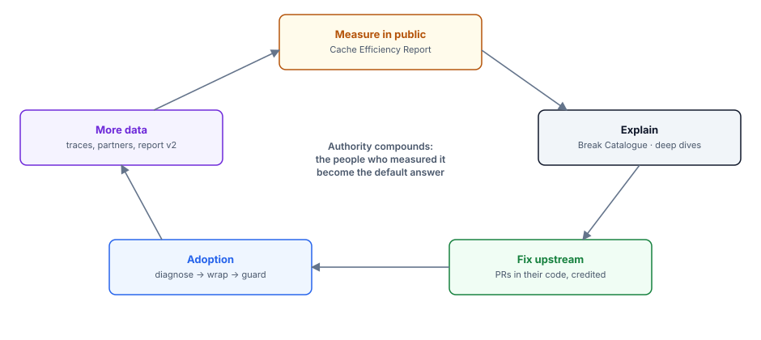
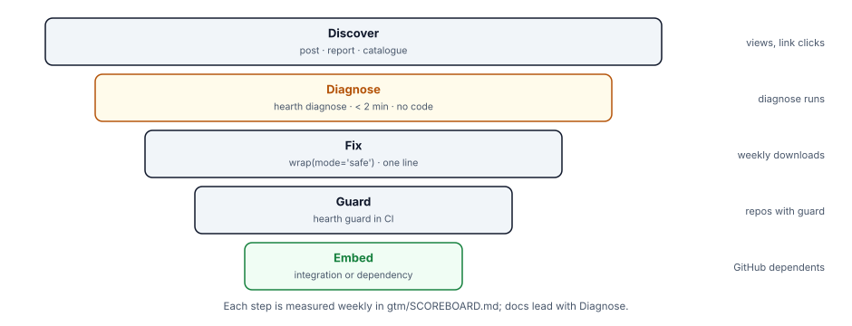

[TOC]

## 1. The strategy in one page

**Win by being the people who measured it.** Every agent team is paying for tokens it already sent, and almost nobody can see it. Hearth wins by publishing the numbers first, explaining the causes better than anyone, fixing the problem in other people's code, and shipping the library that keeps it fixed.

| Goal | What it means here | How it is measured |
|---|---|---|
| **Authority** | When someone asks "why is our agent bill so high?", the answer links to Hearth's report or break catalogue | Report citations and links; upstream fixes merged; invitations to talk or write |
| **Adoption** | Hearth runs inside other teams' agents and their CI | PyPI downloads (excluding CI noise), GitHub dependents, issues and PRs from strangers, framework docs mentioning Hearth |
| **Acquisition visibility** | The platforms that care about token spend know Hearth and the person behind it | Conversations with engineers at target companies; design partners with real workloads |
| **Learning** | Abhranshu can explain every provider's cache rules, the simulator and the cost model from first principles | Three long-form posts written in his name and defended in comments |

**The three assets that do the work:**
1. **The Agent Cache Efficiency Report.** The same 20 tasks run through popular agent frameworks, with and without Hearth, measuring read share, cost per task, time to first token and success. Open harness, one command to reproduce.
2. **The Cache Break Catalogue.** Every way an agent breaks its own cache. Each entry has a real public example, how to detect it, how to fix it, and a test.
3. **`hearth diagnose`.** Point it at a trace file and in two minutes it tells you where your money went. This is the free first step that leads to the library.

## 2. Positioning

| | |
|---|---|
| One-liner | **Your agent is paying full price for tokens it already sent.** |
| What Hearth is | A Python library that keeps an AI agent's prompt cache warm, and proves it |
| For | Engineers running agents on Anthropic, OpenAI or Gemini, especially LangGraph, OpenAI Agents SDK and Pydantic AI users, and anyone with a growing model bill |
| Proof | The report, the catalogue, and before/after numbers from `hearth report` on the user's own agent |
| Category to own | **Cache efficiency.** It becomes a number teams track, like p99 latency |
| How to talk about others | Credit the frameworks and providers. Problems are shown with public issue links and numbers, never mocked. "Policy and tooling vary; here is what we measured" |

**Metric definitions Hearth publishes** (`docs/METRICS.md`), so others can adopt them:

| Metric | Definition |
|---|---|
| **Read share** | cache-read input tokens ÷ total input tokens |
| **Input cost ratio** | actual input cost ÷ the same tokens at uncached price |
| **Break rate** | prefix breaks per 100 calls, by cause code |
| **Wasted spend** | cost of tokens rewritten because of user-caused breaks |

These map to the OpenTelemetry attributes `gen_ai.usage.cache_read.input_tokens` and `gen_ai.usage.cache_write.input_tokens`. Proposing derived metrics to the OTel GenAI group is a later authority move, once the report exists.

## 3. The scoreboard (the GTM agent updates it every Friday)

Targets are aspirations used to steer. They are not public claims.

| By | Authority | Adoption | Acquisition visibility | Gate |
|---|---|---|---|---|
| Week 2 (end of M0) | Kill-test write-up drafted; published whatever the result (§13) | — | ≥ 6 interviews done | **Kill gate:** the build handbook's §10.1 decision table, including the interview gate in §9 here |
| Week 6 | Break Catalogue posts cover ≥ 10 cause codes; deep dive #1 published | Repo public and `0.1.0a1` installable (D-09); 2 external people ran `diagnose` | 3 conversations with engineers at framework or platform companies | — |
| Week 7 | Report data frozen; maintainers of the 4 measured frameworks get their numbers and the method | — | Maintainer replies logged | Report reproducible from one command |
| Week 8 | **Cache Efficiency Report v1** published; deep dive #2 | — | — | Maintainer corrections addressed |
| Week 9 | — | 3 outsider trials on `0.1.0b1` | 3 design-partner conversations | Trials logged in `gtm/TRIALS.md` |
| Week 10 (launch) | Show HN; launch post | v0.1 on PyPI | — | Release checklist |
| Week 16 | ≥ 3 upstream fixes merged; ≥ 1 invited talk, podcast or guest post | ≥ 1,000 weekly downloads (pypistats, without mirrors; includes some CI, stated as such); ≥ 10 repos in GitHub "Used by" (counted by hand); ≥ 5 issues or PRs from strangers | ≥ 2 design partners with real workloads; ≥ 1 conversation with a target acquirer's engineering lead | Review: continue, narrow, or stop |

**How each number is collected:**
- **Fetched by the GTM agent (read-only public data):** downloads via pypistats (without mirrors), GitHub stars, issues and PRs. The "Used by" count is read from the repo page by Abhranshu, because there is no API for it.
- **Pasted in by Abhranshu:** post reach, replies, conversations.
- **Where it goes:** everything lands in `gtm/SCOREBOARD.md` with the date and source.

## 4. The adoption funnel

| Step | What the user does | Friction target | What makes them take the next step |
|---|---|---|---|
| **Discover** | Reads a post, the report or a catalogue entry | — | A number about *their* framework |
| **Diagnose** | `pip install hearth-ai`, then `wrap(mode="observe", record=True)` for one session and `hearth diagnose` on the trace | Under 2 minutes; one line added, nothing changed in behaviour | Seeing their own read share and the exact text that broke it |
| **Fix** | `mode="safe"` (or `optimize`) | One line | `hearth report` showing the before and after |
| **Guard** | `hearth guard` in CI | One CI step | A failed build the first time someone adds a timestamp |
| **Embed** | Uses the framework integration; lists Hearth as a dependency | — | It just stays there, which is the adoption that acquirers value |

**The rule for the README and docs:** they lead with `diagnose`, because a free diagnosis is the lowest-risk first step and creates the reason to install the library.

## 5. Authority plan: four moves, in order

### 5.1 Measure in public (weeks 1–7)
- **Kill-test write-up (week 2, only if the gate passes):** "We measured how three agent frameworks use the prompt cache." It carries real numbers, the method, and the limits.
- **Report v1:** the pre-registered suite, 4 frameworks (a custom loop, Pydantic AI, the OpenAI Agents SDK, LangGraph), 2 providers, both agent templates. Data freezes in week 7; the report is published in week 8 as `docs/REPORT.md` plus a long-form post. Everything is reproducible with `hearth bench --report`.
- **Before publishing (week 7):** send each measured framework's maintainers their numbers and the method, and invite corrections. Abhranshu sends these; the agent drafts them. This is fair, it improves accuracy, and it starts relationships with exactly the people Hearth needs.

### 5.2 Explain better than anyone (weeks 3–10)
**The Break Catalogue.** The build generates `docs/BREAKS.md` from its cause registry (`breaks.yaml`). The GTM agent writes one post per cluster from it. Each entry has:
- the cause;
- a public example, as an issue link;
- how to detect it (the guard's cause code);
- a minimal reproduction;
- the fix;
- the provider doc section.

**Deep dives** (the technical-authority pieces, written in Abhranshu's name):
1. **Week 6:** "When does compaction pay for itself?", from the M2 compaction study. The title stays a question until claim C-09 is proven.
2. **Week 8:** "Simulating a provider's prompt cache", covering the simulator and its hold-out calibration error.
3. **Week 10 or after launch:** "Switching models mid-session: the hidden rewrite", only if M6 ships (see the cut-line mapping in §6).

### 5.3 Fix it upstream (weeks 5–16)
For each public issue where Hearth's diagnosis applies (Mastra, smolagents, TradingAgents, the OpenAI Agents SDK sub-agents, the Vercel AI SDK, and others found later):
1. reproduce with `hearth diagnose`;
2. comment once with numbers and the likely cause, offering help;
3. if maintainers welcome it, the GTM agent drafts a minimal patch description and fix (in `gtm/upstream/`) for the layout **in their code, without adding a Hearth dependency**. Abhranshu forks, codes and opens the PR himself;
4. log it in `gtm/UPSTREAM.md`.

**Scope:** only issues reproducible in Python with the bench's mock tools. TypeScript projects (Mastra, the Vercel AI SDK) get a comment with Hearth's measurements of the equivalent Python pattern, not a reproduction. Reproduction runs use the GTM line of the API budget (DECISIONS D-02).

Merged fixes are the strongest proof of skill and the best source of goodwill. Hearth gets mentioned because the numbers came from it, not because it was promoted.

### 5.4 Set the standard (after week 10)
- Publish `docs/METRICS.md` and ask two other projects (observability tools or frameworks) to report read share the same way.
- Offer the derived metrics to the OpenTelemetry GenAI semantic-conventions group as an issue, with the report as evidence.
- Submit a talk proposal on the report to an AI engineering conference.

## 6. The content engine (what the GTM agent produces, every week)

| Week | Build milestone | Assets prepared | Abhranshu does |
|---|---|---|---|
| 1 | M0 starts | Interview script; 20 outreach drafts; problem post #1 ("the timestamp that turns a cached prompt into a full-price one", with public issue links); architecture diagram | Sends 10 outreach messages; publishes post #1 |
| 2 | M0 gate | Kill-test write-up (published whatever the result); 10 more outreach drafts; a mock `diagnose` output built from M0 traces, to show in interviews | Interviews; decides go, narrow or stop |
| 3 | M1 | Catalogue entries 1–5; post: "how to read your own cache numbers in 5 minutes" (provider usage fields) | Publishes 1 post |
| 4 | M1 gate | `hearth report` and `diagnose` terminal GIFs (VHS); README draft | Publishes GIF post |
| 5 | M2 | Catalogue posts 6–10; first upstream comments drafted | Publishes; posts upstream comments |
| 6 | M3 | Deep dive #1 (compaction study); integration examples as posts (one per framework) | Publishes |
| 7 | M4 | Maintainer preview packets for the report; report page and long-form post drafted | Sends previews to maintainers |
| 8 | M5 | **Report v1** published, with a 6-image summary and a 3-minute walkthrough script; deep dive #2 (simulator); memory post | Publishes the report; records the walkthrough |
| 9 | M6 | Trial guide for `0.1.0b1`; Show HN draft; launch post; FAQ (15 questions, including "Isn't this just provider auto-caching?" and "How is this different from prefixcash?"); press kit | Recruits and supports 3 outsiders trying it cold |
| 10 | M7 | Final README draft; launch-day checklist; reply bank; deep dive #3 if M6 shipped | **Launch:** Show HN, LinkedIn, X, Reddit, newsletters; answers comments all day |

**Cut-line mapping:** if M6 moves to 0.2, drop deep dive #3, claim C-11 and the FAQ entries about switching. If M5 moves, drop the memory post. The report and the catalogue are never cut.
| 11–16 | 0.1.x | Weekly "what we measured this week"; catalogue updates; upstream PR log; scoreboard | 2 posts a week; partner calls |

**Format rules:**
- every post carries one real number from STATUS or the report, and one link;
- videos are terminal recordings rendered from VHS tapes (reproducible) plus short screen recordings Abhranshu makes from the agent's script;
- diagrams come from the repo's own diagram scripts, so they stay in sync with the code.

## 7. Voice rules (hard; applied to everything published under Abhranshu's name)

1. No em dashes and no en dashes used as punctuation.
2. No rhythm triads ("faster, cheaper, smarter"). No "it's not X, it's Y." No rhetorical-question openers.
3. One concrete number, failure or command per post. LinkedIn up to 120 words; X up to 2 posts; Show HN text up to 150 words.
4. First person, plain, understated: an engineer showing measurements, not a founder selling.
5. Credit others by name when using their public issue or work.
6. Each draft file ends with a check line (not part of the post): `voice-check: dashes 0 · triads 0 · number yes · links 1 · credits yes`.

## 8. Channels and their rules

| Channel | Use | Rule |
|---|---|---|
| LinkedIn, X (Abhranshu) | 2 posts a week | Lead with the measured problem |
| Repo `docs/` and dev.to | Report, catalogue, deep dives | One canonical URL per piece |
| Show HN | Launch only | Must be runnable today; never ask for votes; reply for hours |
| Framework communities (LangChain forum, Mastra and Pydantic community channels, OpenAI Agents SDK discussions) | Integration examples, report previews | Read each community's self-promotion rules first and record that in `gtm/CHANNELS.md` |
| r/LocalLLaMA, r/ClaudeAI, r/OpenAI, r/MachineLearning | Report and deep dives | Engineering write-ups, not announcements; check rules first |
| GitHub issues and PRs upstream | Fixes | §5.3 rules; one helpful comment; no link-dropping |
| Newsletters and podcasts (AI engineering newsletters, Latent Space-style shows) | After the report | One personal pitch each, with the report link |
| Conferences (AI engineering CFPs) | After launch | Talk built on the report |

## 9. Interviews and design partners (part of the M0 kill gate)

- **Who:** engineers or leads running agents in production on paid APIs. Names and handles live only in `gtm/private/` (gitignored); committed files use roles.
- **Outreach shape:** under 70 words in Abhranshu's voice. A specific observation about their product or post, one question, and an offer of a 20-minute call. No pitch.
- **Questions:**
  1. What does your agent run on?
  2. Do you know your cache read share?
  3. What is your monthly model spend, as a range?
  4. What would make you add a library to your model calls?
  5. What would stop you?
  6. **The gate question, asked verbatim after showing the mock `diagnose` output:** "If a free command showed you, from one session of your agent, exactly which part of the prompt breaks your cache and what it costs, would you run it on your agent this month?"
- **Gate:** at least 6 interviews completed, and at least half answer yes to question 6. If fewer than 6 are done by the end of week 2, extend by one week while the build continues. Outreach volume: 20 messages in weeks 1–2.
- **Design partners (after M3):** teams willing to run `observe` mode for a week and share aggregate numbers (not prompts). Offer: a free diagnosis and fixes. Logos only with written permission.

## 10. Acquirer map (inference from 2025–26 deals)

| Buyer type | Examples | Why Hearth fits | How to become visible |
|---|---|---|---|
| Platforms selling model access or token spend | Stripe (OpenRouter), Cloudflare (AI Gateway, Auto Router), Vercel (AI Gateway, AI SDK) | Lower token bills for their users; Cloudflare already prices cache loss into routing | TypeScript port for the Vercel AI SDK; report includes gateway-routed runs |
| Agent frameworks | LangChain, Mastra, Pydantic | Fixes a top user complaint without rebuilding their stack | Upstream fixes; integrations in their docs |
| Inference and cloud | DigitalOcean (bought Katanemo), Databricks, Snowflake | Agent cost is a sales objection | Report on their models or endpoints where offered |
| Observability | Datadog, Dynatrace (Arize), ClickHouse (Langfuse) | Cause analysis on top of token telemetry | OTel export; a Langfuse integration example |
| Model providers | Anthropic, OpenAI, Google | Developer success with caching | Accurate catalogue; provider-specific deep dives; DevRel contact via public work |

**Reality check.** Most 2026 deals for small open-source projects were for teams with real distribution, and prices were undisclosed. Optimise for dependents and maintainer relationships, not for stars. Acquisition within a year stays a low-probability outcome; authority and the network it builds are the likely payoff.

## 11. Claims, proof and testing as content

- **Claims ledger:** every public claim lives in `gtm/CLAIMS.md` with its proof (test name, bench run ID, report version, recording) and a state. Only `proven` claims may be used, word for word or narrower.
- **Testing as content:** each catalogue entry links to its test in `tests/` and its guard cause code, so the catalogue doubles as public evidence of engineering rigour.
- **Honesty markers:**
  - publish where Hearth did *not* help (for example short prompts below the cache minimum);
  - state the simulator's calibration error;
  - list known limits in the README.

This is what makes the numbers trusted.

## 12. How the GTM agent runs autonomously

| It does on its own | It prepares for Abhranshu | It never does |
|---|---|---|
| Reads STATUS, the bench output and the report from the build branch; moves claims to `proven`; drafts every asset; renders VHS media; fetches public metrics; updates the scoreboard and calendar; writes `gtm/NEXT.md` | Posts ready to publish; outreach messages to send; recording scripts; upstream comments to post; a weekly 10-line summary of scoreboard movement and the one decision needed | Post, send, DM, email, comment, open PRs upstream, sign up for anything, invent numbers or quotes |

**Weekly rhythm:**
- **Monday:** the agent writes NEXT.md for the week.
- **Tuesday and Thursday:** Abhranshu publishes.
- **Friday:** the agent updates the scoreboard and states whether each target is on track, at risk or missed, with one proposed adjustment.

**Escalation rule:** if any scoreboard line is "missed" two weeks running, the agent proposes a change of tactic, not more of the same.

## 13. Competitive response

| If | Then |
|---|---|
| prefixcash or another tool ships automatic layout fixes | Compete on integrations, simulator accuracy and the report; credit them; consider collaborating on the metric definitions |
| A provider ships richer diagnostics | Read them in the adapter (Hearth already plans to use OpenAI's `comparison_response_id`); keep the cross-provider view |
| A framework fixes its layout after Hearth's report | Celebrate it publicly with the before/after numbers; that is the authority outcome |
| The kill test fails | Publish the honest finding anyway ("frameworks already cache well; here is the data"). It still builds credibility. The project then narrows or stops, per the build handbook's §10.1 table |

## 14. Launch checklist (week 10)

- **Product:** the release checklist in the build handbook is complete, and `pip install hearth-ai` works on a clean machine.
- **Content:** report v1 is live; catalogue posts cover at least 10 cause codes; deep dives #1 and #2 are published; the FAQ is done.
- **Trials:** three outsider trials on `0.1.0b1` are logged (week 9); the README claims all map to `proven` rows.
- **Show HN:** posted on a Tuesday or Wednesday morning US Pacific time. Abhranshu answers for the whole day, using the reply bank as a starting point, never pasted verbatim.
- **Day-after review:** what people asked, what broke, what to fix this week. Logged in SCOREBOARD.
